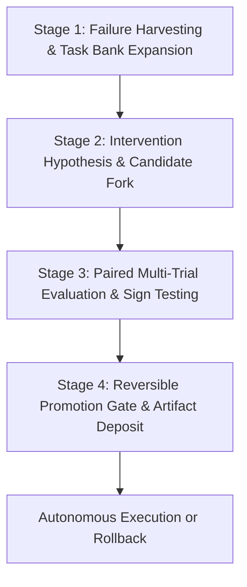

# Agent Evolution ($agent-evolution)

**Outcome:** Tested workflow candidate and reversible promotion decision.  
**Compounding Asset:** Curated task bank, measured intervention logs, and regression test suites.

---

## Workflow Overview

Agent Evolution powers continuous, self-directed improvement of agent workflows, prompts, tools, and cognitive configurations. It requires rigorous paired evaluations against frozen baselines, enforces exact sign-test thresholds, and insists on instant, single-command reversibility.



---

## Operating Instructions

### Stage 1: Failure Harvesting & Task Bank Expansion
1. Ingest failed conversation transcripts, unhandled tool errors, and benchmark regressions.
2. Formulate deterministic task fixtures with objective grading rubrics (asserts, exit artifacts).
3. Append verified fixtures to the permanent evaluation task bank.
*Exit Artifact:* `01-harvested-tasks.json`

### Stage 2: Intervention Hypothesis & Candidate Fork
1. Define the specific structural intervention (prompt tweak, tool addition, schema refactor, rule addition).
2. Establish resource ceilings (max token multiplier $\le 1.25\times$, max latency $\le 1.1\times$).
3. Fork workflow or branch workspace in an isolated sandbox.
*Exit Artifact:* `02-intervention-spec.md`

### Stage 3: Paired Multi-Trial Evaluation & Sign Testing
1. Execute paired runs across identical tasks with matching seed and model compute.
2. Run the bundled paired evaluator helper:
   ```bash
   python3 /home/ae/plugins/aegntic-agent-evolution/evaluator/evaluator.py \
     --baseline baseline_runs.json \
     --candidate candidate_runs.json \
     --contract evolution_contract.json
   ```
3. Check statistical significance: exact one-sided sign test $p < 0.05$ and practical gain $\ge \text{threshold}$.
*Exit Artifact:* `03-paired-evaluation-report.json`

### Stage 4: Reversible Promotion Gate & Artifact Deposit
1. If evaluation returns `PROMOTE` and zero critical failures, generate promotion manifest.
2. If evaluation returns `REJECT` or `INCONCLUSIVE`, archive run record and log intervention failure.
3. Provide single-command rollback recipe for instant rollback if production regression occurs.
*Exit Artifacts:* `promotion-decision.md`, `rollback-recipe.sh`, `run_record.json`

---

## Evaluator Integration

The paired evaluator helper is standard across all Aegntic plugins:

```bash
python3 /home/ae/plugins/aegntic-agent-evolution/evaluator/evaluator.py \
  --baseline baseline_results.json \
  --candidate candidate_results.json \
  --output evaluation_report.json
```

---

## Bundled References (`library/`)
Specialist materials, benchmark harness templates, and cognitive OS directives live under `/home/ae/plugins/aegntic-agent-evolution/library/` to avoid polluting the global skill namespace.
