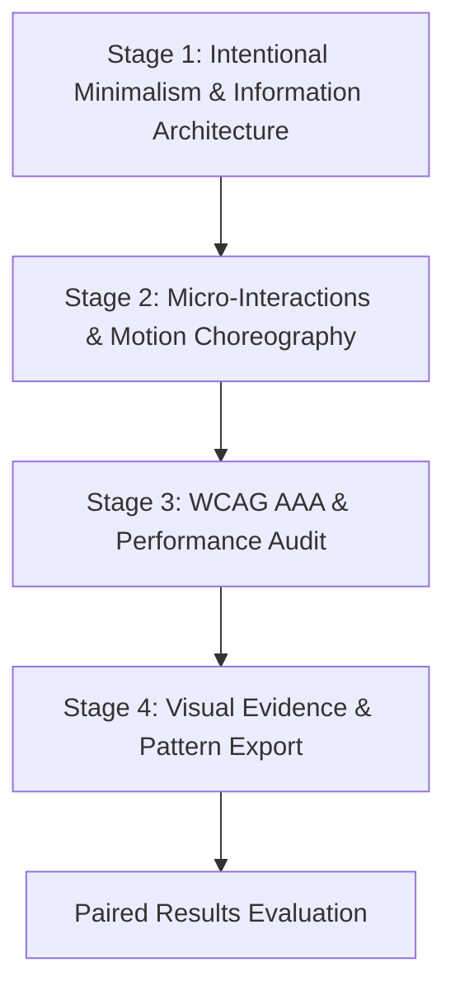

# Experience Studio ($experience-studio)

**Outcome:** Implemented interface with interaction and accessibility evidence.  
**Compounding Asset:** Reusable interface design patterns and usability regression test suites.

---

## Workflow Overview

Experience Studio crafts bespoke, avant-garde digital interfaces. It rejects generic templates ("anti-AI slop"), enforces Intentional Minimalism, and proves compliance through automated visual and accessibility testing.



---

## Operating Instructions

### Stage 1: Intentional Minimalism & Information Architecture
1. Define aesthetic direction (Technical Precision, Brutalist Minimalism, Neo-Noir, etc.).
2. Lock typography tokens (Space Grotesk, JetBrains Mono — strictly no Arial/Helvetica/Inter).
3. Structure whitespace, visual hierarchy, and deliberate asymmetrical balance.
*Exit Artifact:* `01-design-tokens.json`

### Stage 2: Micro-Interactions & Motion Choreography
1. Implement interactive states: hover glows, focus rings, magnetic buttons, and telemetry counters.
2. Choreograph entrance sequence (staggered delay 0ms -> 200ms -> 400ms).
3. Enforce `@media (prefers-reduced-motion: reduce)` dampening across all animated elements.
*Exit Artifact:* `02-interaction-specs.css`

### Stage 3: WCAG AAA & Performance Audit
1. Audit color contrast ratios ($\ge 4.5:1$ for body text, $\ge 3:1$ for UI boundaries).
2. Validate keyboard navigability: complete tab navigation without focus traps.
3. Optimize Core Web Vitals: apply `content-visibility: auto` to below-the-fold content blocks.
*Exit Artifact:* `03-accessibility-audit.json`

### Stage 4: Visual Evidence & Pattern Export
1. Capture multi-viewport visual evidence (Desktop 1400px, Tablet 768px, Mobile 390px).
2. Extract reusable UI primitives into the project's component directory.
3. Record run state in `.experience-studio/run_record.json`.
*Exit Artifacts:* `ui-evidence-dossier.md`, `screenshots/`, `run_record.json`

---

## Evaluator Integration

```bash
python3 /home/ae/plugins/aegntic-experience-studio/evaluator/evaluator.py \
  --baseline baseline_ui_run.json \
  --candidate candidate_ui_run.json \
  --contract studio_contract.json
```

---

## Bundled References (`library/`)
Specialist materials, visual design tokens, and accessibility checklists live under `/home/ae/plugins/aegntic-experience-studio/library/` to avoid polluting the global skill namespace.
