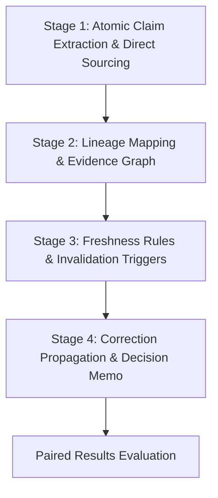

# Knowledge Engine ($knowledge-engine)

**Outcome:** Sourced decision plus reusable, versioned knowledge assets.  
**Compounding Asset:** Claim lineage graph, freshness decay rules, and correction propagation hooks.

---

## Workflow Overview

Knowledge Engine turns disparate research, data points, and operational observations into durable, traceable truth. It requires atomic claim lineage, measures decay half-life, and ensures corrections propagate across downstream systems.



---

## Operating Instructions

### Stage 1: Atomic Claim Extraction & Direct Sourcing
1. Decompose research material into atomic, falsifiable claim statements.
2. Bind every claim to a primary source (URL, commit sha, paper DOI, or telemetry receipt).
3. Classify claims by epistemic strength: empirical measurement > audit receipt > provider claim.
*Exit Artifact:* `01-atomic-claims.json`

### Stage 2: Lineage Mapping & Evidence Graph
1. Build the DAG of premises leading to the candidate decision.
2. Identify single-point-of-failure assumptions and external dependencies.
3. Compute weighted confidence scores based on source authority and sample size.
*Exit Artifact:* `02-evidence-dag.json`

### Stage 3: Freshness Rules & Invalidation Triggers
1. Define expiration half-life for each evidence class (e.g. API specs: 14 days, pricing: 7 days).
2. Establish automated re-validation conditions and watch triggers.
3. Specify explicit disconfirming signals that instantly invalidate the decision.
*Exit Artifact:* `03-freshness-spec.json`

### Stage 4: Correction Propagation & Decision Memo
1. Author the definitive, sourced decision memorandum.
2. Generate downstream invalidation hooks to alert dependent models/agents on contradiction.
3. Record run state in `.knowledge-engine/run_record.json`.
*Exit Artifacts:* `decision-memorandum.md`, `lineage-graph.json`, `run_record.json`

---

## Evaluator Integration

```bash
python3 /home/ae/plugins/aegntic-knowledge-engine/evaluator/evaluator.py \
  --baseline baseline_knowledge_run.json \
  --candidate candidate_knowledge_run.json \
  --contract knowledge_contract.json
```

---

## Bundled References (`library/`)
Specialist materials, truth synthesis guides, and citation standards live under `/home/ae/plugins/aegntic-knowledge-engine/library/` to avoid polluting the global skill namespace.
