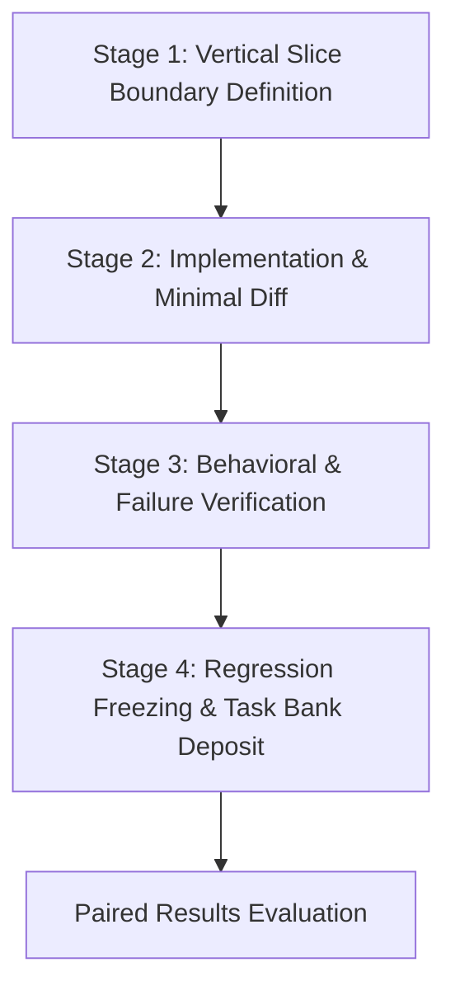

# Product Foundry ($product-foundry)

**Outcome:** Working vertical slice with behavioral and regression evidence.  
**Compounding Asset:** Tested components, verified recovery procedures, and regression test cases.

---

## Workflow Overview

Product Foundry builds the smallest complete, functioning slice of an application or service. It enforces tight semantic boundaries, requires verified behavioral proof, and preserves regression suites as permanent assets.



---

## Operating Instructions

### Stage 1: Vertical Slice Boundary Definition
1. Identify the single critical user or machine path (e.g. auth -> execute -> receipt).
2. Lock interface schemas, data contracts, and external boundary mock requirements.
3. Freeze definition of done: unit coverage, type checks, build pass, and behavior criteria.
*Exit Artifact:* `01-slice-contract.json`

### Stage 2: Implementation & Minimal Diff
1. Implement the minimal codebase changes necessary to satisfy the slice contract.
2. Adhere to strict library discipline (use existing primitives, avoid reinventing components).
3. Validate locally: typecheck -> lint -> unit test -> build.
*Exit Artifact:* `02-slice-implementation.diff`

### Stage 3: Behavioral & Failure Verification
1. Run automated behavioral tests against running service or mock harness.
2. Execute failure injection: test timeouts, network drops, malformed payloads.
3. Document exact recovery behavior and system survivability.
*Exit Artifact:* `03-behavioral-evidence.json`

### Stage 4: Regression Freezing & Task Bank Deposit
1. Package the test case into the repository's permanent test suite.
2. Deposit task definition and grading script into the task bank for agent evaluation.
3. Record run state in `.product-foundry/run_record.json`.
*Exit Artifacts:* `slice-summary.md`, `regression-suite.test.mjs`, `run_record.json`

---

## Evaluator Integration

```bash
python3 /home/ae/plugins/aegntic-product-foundry/evaluator/evaluator.py \
  --baseline baseline_test_run.json \
  --candidate candidate_test_run.json \
  --contract foundry_contract.json
```

---

## Bundled References (`library/`)
Specialist materials and reference playbooks live under `/home/ae/plugins/aegntic-product-foundry/library/` to avoid polluting the global skill namespace.
