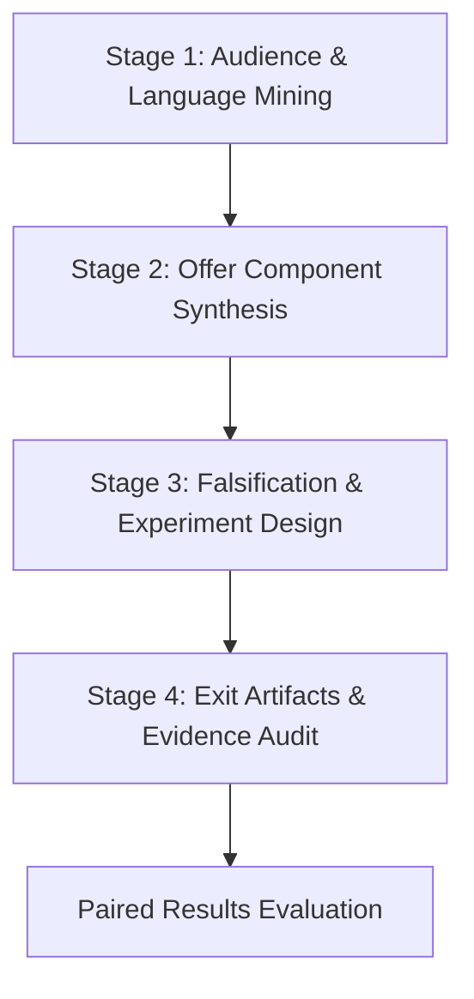

# Venture Lab ($venture-lab)

**Outcome:** Tested offer or a ready-to-run validation experiment with an explicit missing evidence audit.  
**Compounding Asset:** Audience language dictionary, modular offer components, and empirical hypothesis outcomes.

---

## Workflow Overview

Venture Lab takes an ambiguous concept, target market, or capability and drives it through a 4-stage empirical validation loop. It avoids speculative commitments by demanding explicit disconfirming criteria and freezing missing evidence before execution.



---

## Operating Instructions

### Stage 1: Audience & Language Mining
1. Inspect available input materials (briefs, domain research, user transcripts, competitor reviews).
2. Extract the audience's exact vocabulary for pain, stakes, and current workarounds.
3. Identify existing substitutes and their structural failure modes.
*Exit Artifact:* `01-audience-language.json`

### Stage 2: Offer Component Synthesis
1. Formulate the single consequential outcome ($\le 12$ words).
2. Define the scope boundaries: what is included vs. explicitly excluded.
3. Establish the evidence-backed pricing test and failure-closed safety guarantees.
*Exit Artifact:* `02-offer-spec.md`

### Stage 3: Falsification & Experiment Design
1. Define the null hypothesis and minimum detectable effect size.
2. Specify disconfirming evidence rules: what observed outcome proves this invalid?
3. Configure the trial parameters (sample size $N$, duration, attribution mechanics).
*Exit Artifact:* `03-experiment-plan.json`

### Stage 4: Exit Artifacts & Evidence Audit
1. Assemble the comprehensive offer package.
2. Conduct an honest evidence gap audit: flag any claim that rests on unverified assumptions.
3. Store the resumable run record in `.venture-lab/run_record.json`.
*Exit Artifacts:* `tested-offer.md`, `evidence-gap-audit.json`, `run_record.json`

---

## Evaluator Integration

Validate experiment outputs against the local paired evaluator:

```bash
python3 /home/ae/plugins/aegntic-venture-lab/evaluator/evaluator.py \
  --baseline baseline_experiment.json \
  --candidate candidate_experiment.json \
  --contract validation_contract.json
```

---

## Bundled References (`library/`)
Specialist materials and reference playbooks live under `/home/ae/plugins/aegntic-venture-lab/library/` to avoid polluting the global skill namespace.
